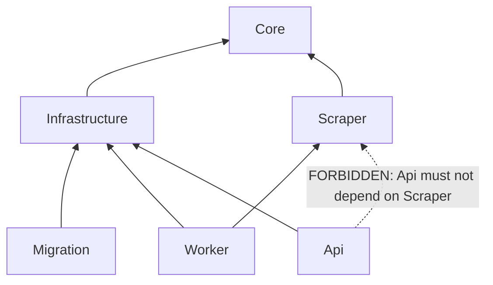

# Architecture

Status legend: see [agents.md](./agents.md#status-legend).

## Solution structure

```
TourSearch.sln
├── src/
│   ├── TourSearch.Api/              # ASP.NET Core (Minimal APIs) + MCP endpoint
│   ├── TourSearch.Worker/           # executable: job queue + scraping
│   ├── TourSearch.Core/             # domain models, interfaces, business logic
│   ├── TourSearch.Infrastructure/   # EF Core: DbContext, repositories
│   ├── TourSearch.Scraper/          # Playwright: TourVisor.ru
│   └── TourSearch.Infrastructure.Migration/  # design-time context for `dotnet ef`
└── tests/
    ├── TourSearch.UnitTests/
    └── TourSearch.IntegrationTests/
```

## Dependencies

`A --> B` means "A depends on B".



| Project | Depends on | Notes |
|---|---|---|
| **Core** | nothing (BCL only) | domain models, `ITourScraper`, status enums |
| **Infrastructure** | Core | EF Core `DbContext`, repositories |
| **Scraper** | Core | implements `ITourScraper` with Playwright |
| **Migration** | Infrastructure | **only** `IDesignTimeDbContextFactory`, no second DbContext |
| **Worker** | Core, Infrastructure, Scraper | the only consumer of Playwright |
| **Api** | Core, Infrastructure | **no Scraper** |

### Why Api must not depend on Scraper `[DECIDED]`

The previous version of this doc had `Api → Scraper`. That is a defect, not a style choice:

- Playwright drags a headless Chromium into the API process: hundreds of MB of RSS and a browser binary on the hot path.
- The API must answer MCP calls in milliseconds; scraping is minutes-long and unstable.
- Api and Worker are deployed as separate processes. A Playwright dependency in Api means a broken browser kills the API, not just the scraping.
- The API never needs to scrape. It needs scraping **state**, which it reads from `SearchJob.Status`.
- The API never needs to trigger scraping. It writes a job to the DB; the Worker picks it up.

If a future requirement needs synchronous scraping in the API, it must be an explicit, separate, opt-in service — not a transitive dependency.

### Why Migration must not redeclare DbContext `[DECIDED]`

The previous version declared `TourSearchDbContext` **inside** the Migration project. That creates two `OnModelCreating()` definitions: the migration model and the runtime model. They drift apart silently, and migrations then generate tables that the runtime does not expect.

Correct shape:

```
TourSearch.Infrastructure.Migration/
├── DesignTimeDbContext.cs   # IDesignTimeDbContextFactory<TourSearchDbContext> only
├── Migrations/
└── TourSearch.Infrastructure.Migration.csproj   # depends on TourSearch.Infrastructure
```

`TourSearchDbContext` lives in **Infrastructure** and is referenced, never copied. The Migration project exists only because `dotnet ef` needs a design-time factory in the project it runs against.

## Migration commands

From the repo root, always pass `--project` explicitly (a bare `cd` into the folder makes the command ambiguous and breaks path-relative settings):

```bash
# add a migration
dotnet ef migrations add AddSearchJobIndexes --project src/TourSearch.Infrastructure.Migration

# list applied/available migrations
dotnet ef migrations list --project src/TourSearch.Infrastructure.Migration

# apply
dotnet ef database update --project src/TourSearch.Infrastructure.Migration
```

> SQL export: the exact flag set (`migrations export` / `generate`) must be verified against `dotnet ef migrations --help` for the installed CLI version. `[OPEN]` — do not copy an unverified command into docs.

The design-time factory runs in a **separate process** from the app. It does not see the app's DI configuration or its secret provider — it must read the same env vars that the shell exports. See [runtime.md](./runtime.md#configuration-and-secrets).

## Configuration and secrets

`appsettings.json` — defaults only, **no secret fields**:

```json
{
  "DbContext": {
    "Host": "localhost",
    "Port": "5432",
    "Database": "tour_search",
    "Secure": false
  }
}
```

Credentials come from outside the committed file:

| Where | Source |
|---|---|
| Local dev | `*.LocalSecrets.env` (User Secrets) — gitignored |
| CI / integration tests | Testcontainers PostgreSQL — credentials generated by the container |
| Production | env vars: `TOURSEARCH_DB_HOST`, `TOURSEARCH_DB_USER`, `TOURSEARCH_DB_PASSWORD` |

`.gitignore` **exists and is tracked** `[FACT]` (verified with `git ls-files`). It already covers `*.LocalSecrets.env`, `**/appsettings.Local.json`, `**/snapshots/**`, the Playwright/Chromium binaries and build output. What is **not** in the repo is sources, tests, CI, `.editorconfig`, a license and `docs/adr/` — those are the only `[PLANNED]` artifacts left.

The secrets patterns are deliberately narrow (`**/secrets`, `**/secrets.*`) rather than `**/secrets*`: this repository runs on a case-insensitive filesystem (`core.ignorecase = true`), so `**/secrets*` would silently ignore a real source file named `Secrets.cs`. See [.gitignore](../.gitignore).

> A literal password in a committed example is a defect even when the value is fake: it teaches the reader a pattern that violates the secrets policy.

## Processes

Two executables, one shared DI graph shape. Details in [runtime.md](./runtime.md).

| Process | Role | Starts `BackgroundService`? |
|---|---|---|
| `TourSearch.Api` | MCP endpoint, reads DB | **No** |
| `TourSearch.Worker` | job queue, Playwright, writes DB | **Yes — the only one** |

If both start a `BackgroundService`, jobs get picked up twice. This is the reason the "who starts BackgroundService" question is resolved explicitly here rather than left implicit.

## Data flow

```
[LLM agent]
    │ MCP: search_tours
    ▼
[TourSearch.Api]
    │ validate params, compute parameters_hash
    ▼
[SearchJob] PostgreSQL, status=Pending
    │
    │ Worker claims job: atomic CAS Pending → InProgress
    │ (writes lease_token, lease_expires_at, attempt+1)
    ▼
[TourSearch.Worker]
    │ Playwright navigate → parse with selectors.json
    │
    ├── success ─────────────────────────────▶ [TourOffer]* + status=Completed
    │                                           (offers_count may be < requested)
    ├── partial failure ──────────────────────▶ status=Completed + degraded=true + warnings[]
    │                                           (some pages parsed; see scraping.md)
    ├── transient failure (network/timeout) ──▶ attempt < max ? Pending (backoff)
    │                                           : Failed + error_code + retryable=false
    └── permanent failure (parse/anti-bot) ───▶ Failed + error_code + retryable=false
    │
    │ MCP: get_search_results (paged)
    ▲
[LLM agent]
```

`lease_expires_at` is what makes a killed Worker recoverable: a lease that expired while the process was being restarted returns the job to `Pending`. Without it, a crash during scraping leaves a permanently stuck `InProgress` job. See [runtime.md](./runtime.md#restart-semantics).

## Key decisions

| Decision | Justification |
|---|---|
| Asynchronous job model | Scraping is minutes-long; MCP calls must return in milliseconds |
| Separate Worker process | Isolates scraper crashes and browser memory from the API |
| `Api` does not depend on `Scraper` | See section above |
| Migration references the runtime `DbContext` | One source of truth for the model |
| Playwright instead of HttpClient | TourVisor renders results dynamically |
| PostgreSQL + JSONB | Reliability, raw scraped payload, good EF Core integration |
| Schema `tour_search` | Isolates app tables from system tables |
| Job claim = atomic CAS + lease | Two workers must never take one job |
| Partial results are `Completed` + `degraded` | Losing half the results is not the same as losing the job |
| Error taxonomy with `retryable` | A transient network error must not permanently kill a job |
